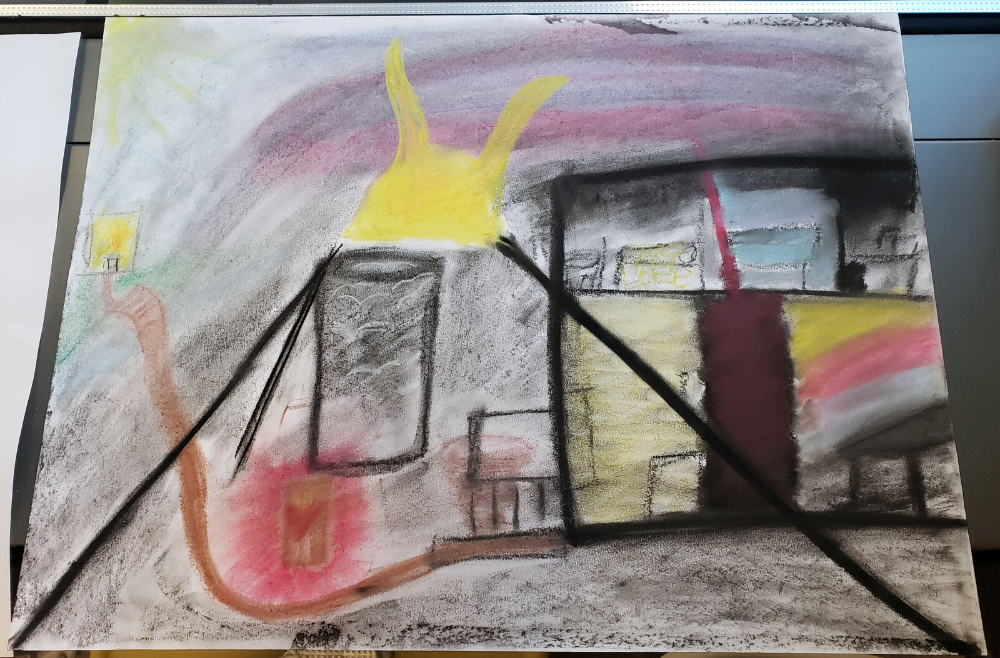
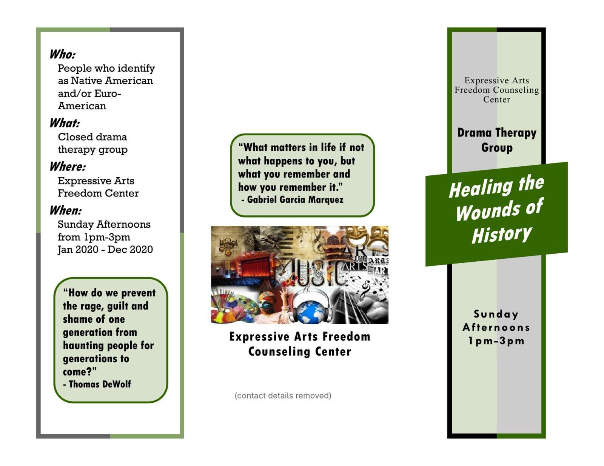
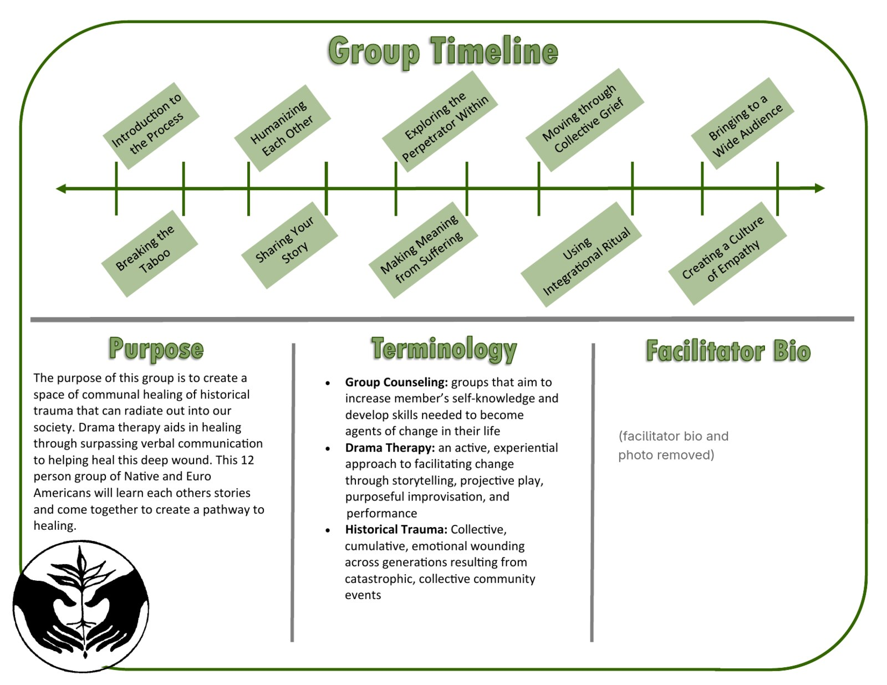
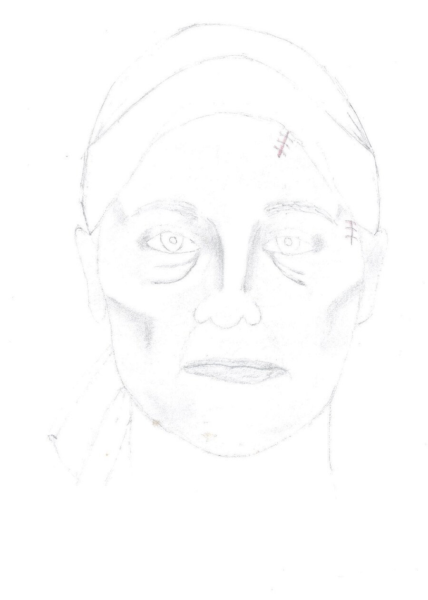
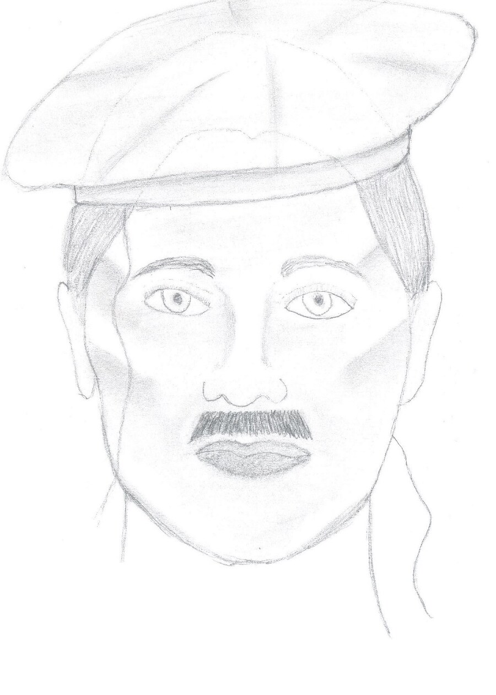
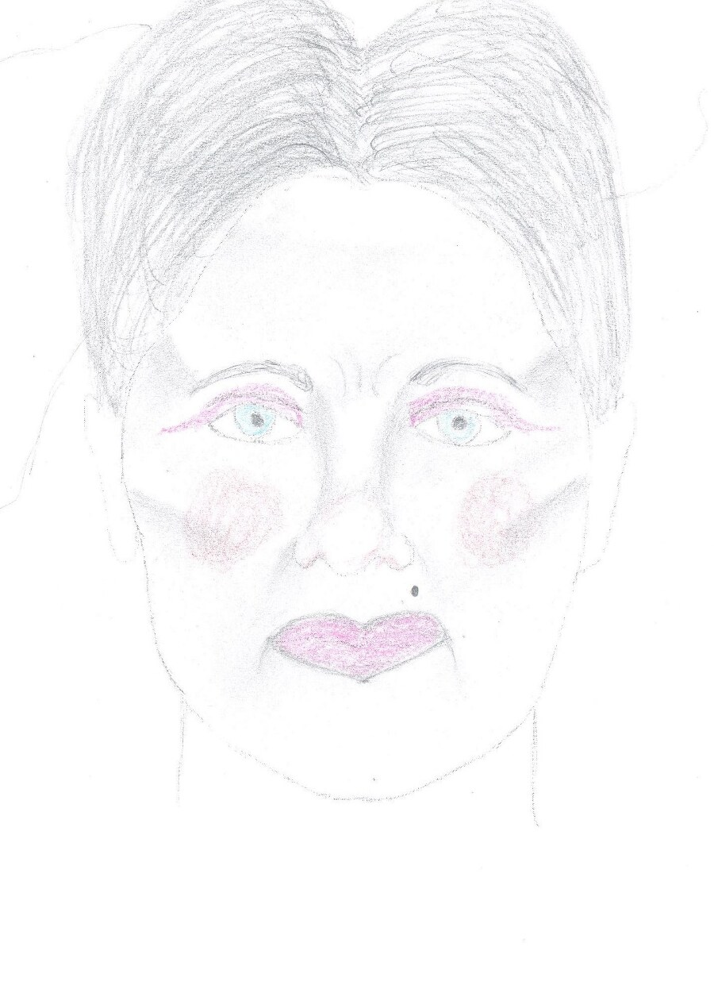
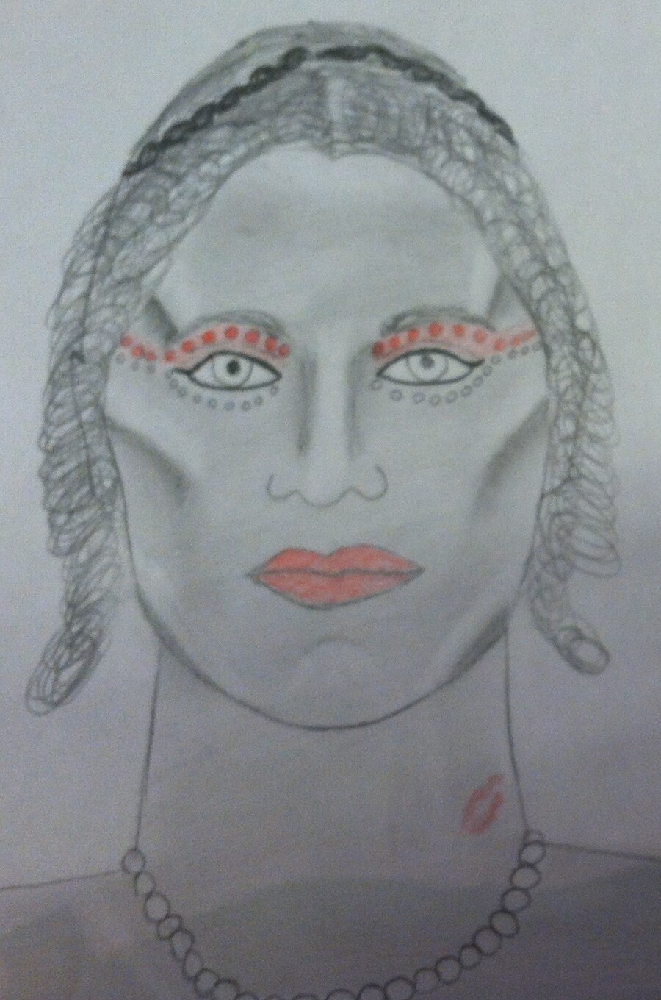
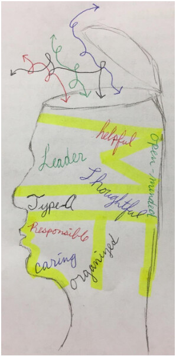
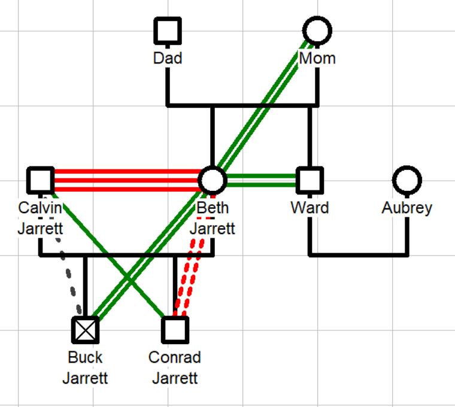

# Visual Arts

Drawings, paintings, and other pieces.

<!-- To add a piece, copy this block, put the image in images/visual-arts/, and fill it in.
     Newest pieces go at the top.

### [Piece Title]
*[Year] · [Medium or Venue]*

[A sentence or two about it.]

-->

### Like Water for Chocolate
*Fall 2018 · Pastel and charcoal on paper, Family of Origin course*

After reading the book *Like Water for Chocolate*, I envisioned the book through location. With locations in mind, I decided to draw what I saw in my mind with colors to represent the people who lived in the spaces most. My background in scenic design helped me consider what this book would look like if reenacted on stage. I asked myself what I would picture toward the end of that play and decided to darken my picture. I then drew light at the end of a tunnel, as Tita saw at the end of the book.

---

### Healing the Wounds of History (Class-project mock-up)
*2019 · Class-project mock-up, brochure design*

Class-project mock-up: a brochure for a fictional twelve-person drama therapy group on healing historical trauma, with a timeline running from "Breaking the Taboo" to "Creating a Culture of Empathy." The center and its contact details are made up, and the contact block and facilitator bio have been covered.

---

### Makeup Design Face Charts
*Undated · Pencil and colored pencil face charts, stage makeup course*

**Lainie, *Bone China*.** The fact that Lainie has cancer and that the cancer is not going well, this will affect her look. She will have a thinner face and bags under her eyes from being tired. She will also have a set frown from worrying and scars from her tumor removal. Lainie will have a scarf around her head to cover the actor's hair and also help keep her head warm from the cold.

**Julia / Sebastian, *The Two Gentlemen of Verona*.** Because Julia is clever and more masculine, I believe she has stronger cheekbones to make her seem more manipulative and strong. She will have a page hat, because she is trying to hide her hair. She is going to have a mustache to add to the effect of hiding her gender identity and to add to the idea of a mask. Sebastian will have some hair falling out of her hat and have darker lips to show the audience that she is still Julia and also to show how easily fooled the other characters are.

**The Duchess, *Alice's Adventures in Wonderland*.** Overall, The Duchess needs to look rather mean to show off how she is violent. She needs to over-do her makeup to fit into Wonderland. She also needs to have an Elizabethan style along with it. To be grumpy she needs to have frown lines by her mouth. She needs to have heart shaped hair in order to show that she is part of royalty, connected to the queen. Because she is constantly around pepper, she also has a red tint around her nose from sneezing and her nose is a little puffy.

**Lechery, *Doctor Faustus*.** Overall, Lechery's colors will mainly be red and black with a little white from the pearls. Black circles will be around the pearls to help them stick out, but also to symbolize how false they are. The pearls are part of Faustus' desire, but the desire is wrong, so they are circled in black. The red is there for symbolism as well. Lechery will look young and thin in the face to look attractive and desirable. She will have her dress hanging off her shoulders for seductive purposes. To show her self-confidence and also help narrow the face, she will have a longer nose to give the illusion of being full of herself. She is going to be a beautiful woman from hell.

Each design started from an eight-question character worksheet (genetics, environment, health, disfigurement, fashion, age, personality, and a summary). The summary answers are shown here.

---

### After
*2017 · Pencil, colored pen, and highlighter*

The "after" half of a before-and-after reflection for an Arts in Healthcare course at the University of South Dakota: instead of a separate self for every role, one united me with her own characteristics.

---

### Jarrett Family Genogram
*2019 · Digital diagram (GenoPro)*

A genogram and relationship map of the fictional Jarrett family, made for my *Ordinary People* paper in Systems Perspectives in Family Therapy.
